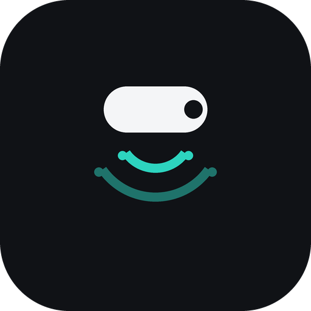

<p align="center">
  
</p>

<h1 align="center">Dynamic Island for Android</h1>

<p align="center">
A Dynamic Island–style capsule around the camera of any Android phone, with eight notification designs, six content layouts and several island styles.
</p>

<p align="center">
  
  
  
  
</p>

[Bahasa Indonesia](README.md)

## Features

Notifications with reply · navigation · payments · music with synced lyrics · calls · timers · downloads · charging · flashlight · hotspot · weather · pinned apps and contacts · Brief (clock, steps, weather) · Liquid Glass · custom colours and fonts · system events.

## Notification designs

App notification cards come in eight genuinely different forms, not just effects: Classic, Card, Ticker (scrolling text beside the camera), Chat, Banner, Split, Headline and Badge. Replies and action buttons work in every design. Pick one from the live gallery in **Appearance → Theme and layout**, or use **Ready-made themes** to set style, layout and notifications at once.

## Layouts and styles

Besides the notification design, the island content has six layouts: Classic, Ring, Labeled, Two lines, Progress bar and Mini. They apply to music, timer, stopwatch, clock, calls (including the incoming-call card), flashlight, downloads and charging.

Island styles: Standard (follows the Color and border settings, with Liquid Glass), HyperIsland, Neon, Gradient, iPhone, Aurora, Sunset and Frost.

## Install

1. Download the APK from **Releases** and install it.
2. Grant the overlay, notification access and accessibility permissions as the app guides you.
3. Turn the island on from Home.

## Build

Standard Gradle project (AGP 8.7, Kotlin 2.1, Compose, minSdk 26):

```bash
./gradlew assembleRelease
```

GitHub Actions builds an APK on every push. For a signed APK add the secrets `KEYSTORE_BASE64` and `KEYSTORE_PASSWORD` (key alias `island`, PKCS12). Optional: the repository variable `SIGNING_CERT_SHA256` pins the certificate fingerprint.

To publish a new version, raise `versionName` and `versionCode` in `app/build.gradle.kts` and add a `## [x.y.z]` section to `CHANGELOG.md` and `CHANGELOG.en.md`.

## Credits

This project builds on the open-source **Dynamic Island** app by [Arusaky (formerly Akira9021)](https://github.com/Arusaky/Dynamic-Island-). Thanks to the original author and contributors. Third-party components: [Inter](docs/licenses/Inter-OFL.txt) font (OFL) and [Ionicons](docs/licenses/Ionicons-MIT.txt) icons (MIT); other notices are in `app/src/main/assets/third-party`.

The app logo, the icon set, the app theme, the notification designs, the content layouts and the Neon, Gradient, iPhone, Aurora, Sunset and Frost styles were made for this version.
