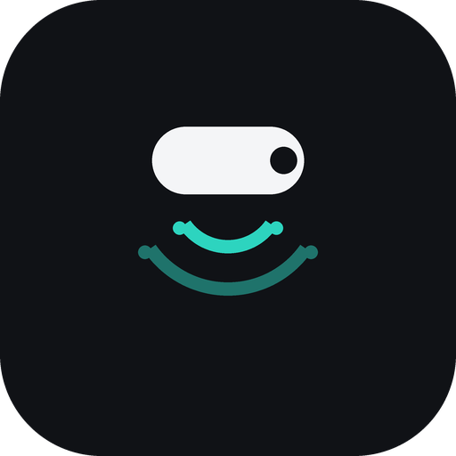

<p align="center">
  
</p>

<h1 align="center">Dynamic Island untuk Android</h1>

<p align="center">
Kapsul ala Dynamic Island di sekitar kamera HP Android mana pun, dengan 8 gaya tampilan.
</p>

<p align="center">
  
  
  
  
</p>

[English](README.en.md)

## Fitur

Notifikasi dengan balasan · navigasi · pembayaran · musik dengan lirik · panggilan · timer · unduhan · pengisian baterai · senter · event sistem.

## Desain notifikasi

Kartu notifikasi aplikasi punya delapan desain dengan bentuk yang berbeda, bukan sekadar efek: Klasik, Kartu, Ticker (teks berjalan di samping kamera), Obrolan (pesan dalam gelembung), Spanduk, Terbelah, Judul besar, dan Lencana. Balasan dan tombol aksi berfungsi di semua desain. Pilih lewat galeri di **Tampilan → Desain notifikasi**, atau pakai **Tema siap pakai** untuk mengatur gaya, tata letak, dan notifikasi sekaligus.

## Tata letak

Selain gaya, isi island punya enam tata letak: Klasik, Cincin, Berlabel, Dua baris, Garis progres, dan Mungil. Pilih di **Tampilan → Tata letak** atau per fitur. Berlaku untuk musik, timer, stopwatch, jam, panggilan (termasuk kartu panggilan masuk), senter, unduhan, dan pengisian.

## Gaya tampilan

Pilih di **Tampilan → Gaya island**, atau atur per fitur (musik, timer, panggilan, pengisian, dll.).

| Gaya | Ciri |
|---|---|
| Dynamic Island | Kapsul hitam klasik, Liquid Glass opsional |
| HyperIsland | Kaca gelap gaya HyperOS dengan cahaya terarah |
| Neon | Badan gelap dengan tepi bercahaya |
| Gradient | Gradien dari warna aksen ke gelap |
| iPhone | Hitam bersih, tepi tipis |
| Aurora | Dua cahaya lembut berwarna dan tepi tiga warna |
| Senja | Jingga → magenta → ungu tua |
| Es Kristal | Kaca biru gelap setengah bening |

## Instalasi

1. Unduh APK dari halaman **Releases** dan pasang.
2. Beri izin overlay, akses notifikasi, dan aksesibilitas sesuai petunjuk di aplikasi.
3. Aktifkan island di layar Beranda.

## Build

Proyek Gradle standar (AGP 8.7, Kotlin 2.1, Compose, minSdk 26):

```bash
./gradlew assembleRelease
```

GitHub Actions membangun APK di setiap push. Untuk APK bertanda tangan, isi secret `KEYSTORE_BASE64` dan `KEYSTORE_PASSWORD` (alias kunci `island`, format PKCS12). Opsional: variabel repo `SIGNING_CERT_SHA256` untuk mengunci sidik jari sertifikat.

Untuk merilis versi baru, naikkan `versionName` dan `versionCode` di `app/build.gradle.kts` lalu tambahkan bagian `## [x.y.z]` di `CHANGELOG.md` dan `CHANGELOG.en.md`.

## Kredit

Proyek ini dikembangkan dari karya sumber terbuka berikut. Terima kasih kepada pembuat aslinya:

- **Dynamic Island** oleh [Akira9021](https://github.com/Akira9021/Dynamic-Island-) — basis aplikasi overlay.
- **HyperIsland** oleh [1812z](https://github.com/1812z/HyperIsland) — acuan gaya kaca HyperOS.
- Font [Inter](docs/licenses/Inter-OFL.txt) (OFL) dan ikon [Ionicons](docs/licenses/Ionicons-MIT.txt) (MIT).

Logo aplikasi dan gaya Aurora, Senja, dan Es Kristal dibuat khusus untuk versi ini.
